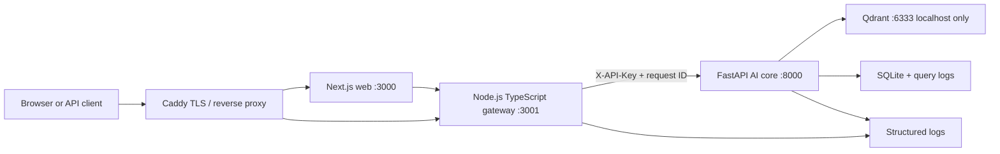

# LegaFetch production architecture

This document describes the repository-backed deployment path. Runtime claims
are limited to evidence in `compose.yaml`, `caddy/Caddyfile`, `DEPLOY.md`,
`RUNBOOK.md`, and the gateway tests.



## Boundaries

| Boundary | Responsibility | Failure behavior |
|---|---|---|
| Caddy → gateway | TLS, compression, public routing | Caddy/backend health determines public availability |
| Gateway → Python API | request ID, bounded body, timeout, auth-header forwarding | `401` for missing API key; `502` for upstream failure |
| Python API → Qdrant | retrieval and vector search | gateway readiness becomes `503` when the dependency is unavailable |
| Deploy → runtime | build, image preservation, restart, smoke checks | failed readiness triggers image rollback in `deploy.sh` |

## Data and recovery

- Qdrant data and snapshots are mounted outside the containers.
- Application SQLite/query logs are persisted under the host-mounted `loglar`
  directory.
- Snapshot and isolated restore evidence is recorded in `OLCUM.md`.
- The repository does not claim automatic backup replication or alert delivery;
  those remain runtime responsibilities to verify on the VPS.

## Evidence commands

```bash
make verify
./scripts/smoke-production.sh https://api.legafetch.com
ssh netcup 'cd /opt/legafetch && docker compose ps'
```
